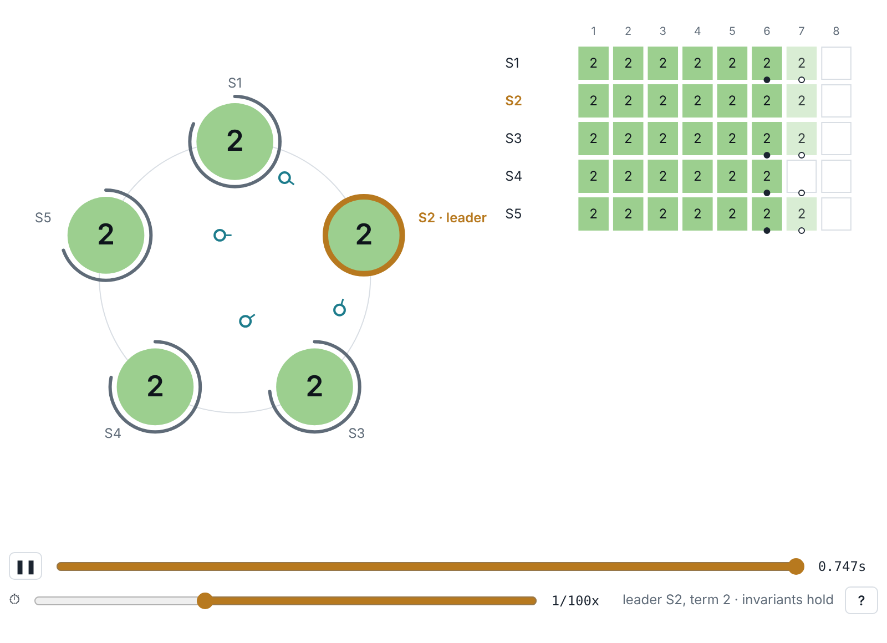

# RaftScope.rs

A drop-in replacement for [RaftScope](https://github.com/ongardie/raftscope), the Raft visualization on [raft.github.io](https://raft.github.io), rewritten in Rust and compiled to WebAssembly.



The protocol is a rule-for-rule port of RaftScope's `raft.js`, with the same constants, the same controls and the same keyboard shortcuts. What changes is the engine underneath:

| | RaftScope (`raft.js`, 2014) | RaftScope.rs |
|---|---|---|
| Cluster size | fixed at 5 (`NUM_SERVERS`) | any *n*: `index.html?servers=51` |
| Reproducibility | `Math.random()`, runs cannot be replayed | seeded PRNG: same seed and same actions give the same run |
| Execution | every rule for every server on every frame | event-driven: work only when something happens |
| Time travel | deep clone of the whole model after every change | sparse checkpoints plus deterministic replay |
| Correctness | not checked | Election Safety, Leader Completeness and State Machine Safety checked online; a violation turns the status red |
| Rendering | SVG rebuilt each frame | Rust builds a draw list; JavaScript paints one canvas |
| Faults | stop, resume, restart, time out, drop a message | plus message loss and network partitions ([lab.html](lab.html)) |
| Dependencies | jQuery, Bootstrap, bootstrap-slider, bootstrap-contextmenu | none; no network requests beyond its own files |

## Using it on raft.github.io

raft.github.io includes RaftScope as a git submodule at `raftscope/` and shows `raftscope/index.html` in an 800×580 iframe. This repository is laid out the same way: `index.html` sits at the root, and the prebuilt browser files are committed in `dist/`, so the submodule works with no build step.

```sh
# in a checkout of raft/raft.github.io
git submodule set-url raftscope https://github.com/OWNER/raftscope-rs
git submodule update --init --remote raftscope
python3 -m http.server   # open http://localhost:8000/#raftscope
```

The page fits the 800×580 frame without scrolling (tested in Chromium against the real site). [docs/UPSTREAM.md](docs/UPSTREAM.md) has the full checklist and a draft pull request. The site's second submodule, `raftscope-replay` (RaftScope's `replay` branch, used with the talk slides), is not covered yet.

## Running it locally

The page loads WebAssembly with `fetch`, so it needs a web server rather than `file://`:

```sh
python3 -m http.server 8000
# http://localhost:8000/           classic view, as on raft.github.io
# http://localhost:8000/lab.html   more servers, faults, statistics, benchmark
```

URL options for `index.html`: `?servers=N` (default 5), `?seed=S` (default random), `?theme=dark` or `?theme=auto` (default light, to match the site).

### Controls

Click a server or a message for its details and actions; right-click works too, as in the original. Drag the timeline to go back in time; acting in the past discards the old future.

| Key | Action |
|---|---|
| space or . | Pause or unpause |
| ? | Help |
| C | Client request to the leader of the highest term |
| R | Restart the leader of the highest term |
| T | Spread election timers (avoid a split vote) |
| A | Align election timers (provoke a split vote) |
| L | Log replication scenario |
| B | Resume all servers |
| F | Fork: discard the future |

### Where WebAssembly is blocked

Some sandboxed pages refuse to compile WebAssembly, for example under a Content-Security-Policy without `'wasm-unsafe-eval'`. The loader then imports `dist/raftscope.wasm.js`: the same Rust, compiled to plain JavaScript with Binaryen's wasm2js. It is 4 to 27 times slower than the WebAssembly build and still far faster than the original.

## Building

```sh
rustup target add wasm32-unknown-unknown   # rust-toolchain.toml asks for it
npm install -g binaryen                     # for the wasm2js fallback
scripts/build.sh                            # rebuilds dist/
node scripts/smoke.mjs                      # both engines load, run, and agree
cargo test --release                        # protocol, safety, determinism, time travel
```

`BUILD_STD=1 scripts/build.sh` builds the standard library from source, for toolchains without the prebuilt wasm32 target.

## Layout

```
index.html              drop-in page (800x580, RaftScope's controls and shortcuts)
lab.html                full page: cluster size, loss, partitions, statistics, benchmark
raftscope.js            loader and canvas painter (~120 lines)
dist/                   prebuilt raftscope.wasm and raftscope.wasm.js (committed)
crates/raftscope-core   simulator, safety checker, time travel, scene builder (no dependencies)
crates/raftscope-wasm   C-ABI exports for the browser (no wasm-bindgen)
crates/raftscope-bench  headless benchmark
bench/compare.mjs       the original raft.js against this port, in one JavaScript engine
bench/results/          recorded benchmark output
scripts/                build and smoke test
```

## Fidelity

Rules, constants (election timeout 100 to 200 ms, latency 10 to 15 ms, RPC timeout 50 ms, heartbeat 50 ms, one entry per AppendEntries) and the log replication scenario match `raft.js`; the test `log_replication_scenario_matches_raftscope` pins the scenario. Two deliberate differences:

- Messages due at the same instant are delivered in arrival-time order; the original used send order.
- A leader tracks per-peer deadlines in a heap and keeps incremental replication counts instead of rescanning all peers. The conditions are the same, solved for time. This is what makes large clusters cheap; the test suite and the online checker guard the equivalence.

## Benchmarks

Recorded on a 2-vCPU x86-64 cloud VM; timings on shared hardware vary between runs, so rerun before quoting. Full output is in [bench/results/](bench/results/).

**The original against the port, both inside Node 22:** per simulated second, the port costs between about 300 and 13,000 times less than `raft.js`, depending on cluster size and on whether time-travel history is kept. Part of that gap is design (event-driven scheduling, replay instead of cloning), not only language.

```sh
git clone https://github.com/ongardie/raftscope /tmp/raftscope
node bench/compare.mjs /tmp/raftscope
```

**Native, 30 simulated seconds, 5 seeds**, one client request every 50 ms:

| Servers | × real time | Elections in 30 s | Commit p50 / p99 | Time without a leader |
|---:|---:|---:|---:|---:|
| 5 | about 40,000× | 1.4 | 24.5 / 27.4 ms | 0.50% |
| 51 | about 4,000× | 11.4 | 25.0 / 25.8 ms | 0.65% |
| 1,001 | about 65× | 219 | 25.0 / 25.2 ms | 0.98% |

No run reported a safety violation. With RaftScope's teaching parameters the simulator also shows three things: split votes grow with cluster size, one entry per message caps throughput near 40 entries/s, and a 50 ms heartbeat is fragile under message loss.

## Branches

- `main`: this drop-in replacement, plain Raft only.
- `gadaa`: a case study built on it. Gadaa-style round-robin leadership (five parties, fixed order, 800 ms terms) on Raft's leadership-transfer mechanism, with its benchmarks and paper.

## Licence

ISC, like RaftScope. [LICENSE-RAFTSCOPE](LICENSE-RAFTSCOPE) carries the original Stanford notice, which covers the protocol logic ported from `raft.js`.
