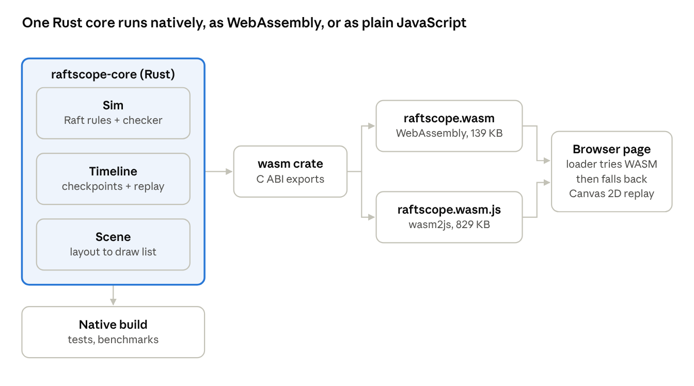
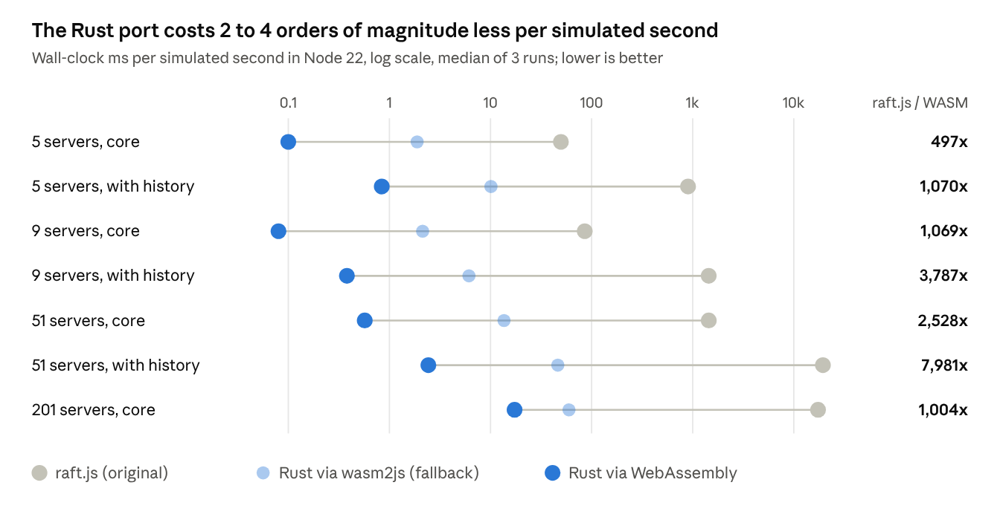

# RaftScope.rs: A Deterministic Raft Visualizer in Rust/WebAssembly, with a Round-Robin Leadership Case Study from Gadaa Governance

Draft, November 2026. The raw benchmark output behind every number is in [results/](results/).

## Abstract

RaftScope, the browser visualization of the Raft consensus algorithm on the Raft website, is fixed at five servers, cannot replay a run, and records history by deep-cloning its model after every change. We present RaftScope.rs, a rule-for-rule port of its protocol logic to Rust, compiled to WebAssembly with a pure-JavaScript fallback. It runs on a deterministic, event-driven engine with an online checker for Raft's safety properties and time travel by checkpoint and replay. Measured in the same JavaScript engine, it costs 2 to 4 orders of magnitude less per simulated second than the original. It scales to 1,001 servers at 70× real time natively. As a case study we model succession in Gadaa, the Oromo democratic system in which five parties hold office in a fixed order for fixed terms. We implement it as round-robin leadership on Raft's leadership-transfer mechanism, with 800 ms terms. Over 750 terms per run, healthy clusters hand office to the next party 100% of the time, with 50 ms median hand-offs and each party leading 19.7–19.8% of the time. Under message loss, crashes and partitions, safety holds in every run, but ordinary elections break the fixed order, down to 24% in-order successions under periodic partitions. This points to an eligibility rule as the missing piece. Code, tests and benchmarks are open source.

## 1. Introduction

Raft is the consensus algorithm most engineers now meet first, and RaftScope is how many of them meet it. Raft was designed for understandability [1]; RaftScope, Ongaro's browser visualization, is the interactive cluster embedded on the Raft website [2]. That page itself calls the visualization rough around the edges and invites pull requests [3].

The stakes reach well beyond teaching. etcd replicates its log with Raft [4], and Kubernetes keeps its entire cluster state in etcd [5]. The name Kubernetes comes from the Greek *kubernētēs*, helmsman, the same root as *governor* and *cybernetics* [5]. Production infrastructure is, quite literally, governed by a consensus protocol.

That etymology suggests a question this paper takes seriously: can a visual simulator of consensus also be a tool for reasoning about human governance protocols? Our case is Gadaa, the indigenous democratic system of the Oromo people, inscribed by UNESCO as Intangible Cultural Heritage in 2016 [6]. In Gadaa, five parties take power in a fixed order; each holds it for eight years, so a party returns every forty years, and the hand-over between parties is a defined process [6]. The BitGadaa project, an art and research project by N.D. Jebessa, has explored Gadaa as inspiration for blockchain-era governance since about 2014 [7]. Fixed-order succession with term limits maps closely onto a known Raft extension, leadership transfer [8].

RaftScope cannot carry that study as it stands. It is fixed at five servers, its runs cannot be replayed, it records history by deep-cloning the whole model after every change, and nothing checks that what it shows is correct.

**Contributions.**

1. RaftScope.rs, a rule-for-rule port of RaftScope's protocol logic to Rust, compiled to WebAssembly, with a deterministic, event-driven engine that scales to 1,001 servers in the browser.
2. An online checker for Raft's safety properties, and time travel built from sparse checkpoints and deterministic replay.
3. A round-robin leadership protocol modelled on Gadaa succession (5 nodes, fixed order, 800 ms terms), built on Raft's leadership-transfer mechanism.
4. An evaluation: the original JavaScript against the port in the same engine, scaling to 1,001 servers, and the Gadaa protocol under crashes and message loss.
5. Open-source code, tests and benchmark scripts that reproduce every number in this paper.

## 2. Background

### 2.1 Raft as RaftScope models it

Raft replicates a log across a cluster through an elected leader [1]. Servers are followers, candidates or leaders, and time is divided into numbered terms. A follower that hears nothing for an election timeout becomes a candidate, increments its term and requests votes; a majority of votes makes it leader. The leader appends client entries to its log, replicates them with AppendEntries, and commits an entry once a majority stores it and it belongs to the current term.

RaftScope's `raft.js` encodes these rules in about 400 lines [2]. Its constants are a 100 ms election timeout (randomised to 100–200 ms), 10–15 ms message latency, a 50 ms RPC retry timeout, heartbeats every 50 ms, and one entry per AppendEntries. Every rule is evaluated for every server on each animation frame. Section 3 keeps these rules and constants and changes only how they are executed.

Raft's safety rests on properties that hold in every reachable state [1]:

- **Election Safety**: at most one leader per term.
- **Leader Completeness**: a leader's log holds every entry committed in earlier terms.
- **State Machine Safety**: no two servers commit different entries at the same index.

### 2.2 Leadership transfer

Ongaro's dissertation adds leadership transfer to Raft [8]. The leader stops accepting new client requests, replicates its log to a chosen target until the target is fully caught up, and then sends it a TimeoutNow message. The target starts an election at once. Because its log is complete and its term is higher, it normally wins in a single round. If the transfer does not finish within an election timeout, the leader abandons it and resumes service.

### 2.3 Gadaa succession

The Gadaa system organises Oromo society into five parties that hold power in a fixed sequence [6]. Each party governs for eight years, so a full cycle takes forty years, and the transfer from one party to the next is a defined process [6]. Because the order is fixed, the parties do not compete with each other for office; competition and consensus happen within a party [6]. For a protocol designer this is a scheme with three properties: a fixed rotation order, a hard term limit, and a scheduled, ceremonial hand-over. Raft's leader is the opposite: it holds office until it fails.

## 3. Design

RaftScope.rs keeps every protocol rule of `raft.js` and replaces the machinery around it. The core is a dependency-free Rust crate of about 1,970 lines (1,320 of them the simulator); the browser module adds about 320 lines of exports and the page's loader about 120 lines, mostly drawing code.



*Figure 1. The same core is compiled for native tests and benchmarks, to WebAssembly for the browser, and to plain JavaScript as a fallback for hosts that block WebAssembly.*

### 3.1 Determinism

Every random choice (election timeouts, message latency, message loss) draws from one xoshiro256\*\* generator [9] seeded from the configuration and stored inside the simulation state. A run is therefore a pure function of its configuration, seed and timed user actions. The test suite checks this by fingerprinting the full state, and it is what makes replay-based time travel (3.4) possible. RaftScope uses `Math.random()`, so no run can be reproduced.

### 3.2 Event-driven execution

The original evaluates every rule for every server on every frame and filters the whole message list each time. RaftScope.rs keeps two priority queues instead: in-flight messages ordered by arrival time, and each server's next wake time. A server's wake time is the earliest instant at which any of its rules could fire, such as its election alarm or a peer's retry deadline. The engine jumps straight to the next event, so idle simulated time costs nothing. Within one instant it runs rules first and deliveries second, as `raft.update` does, and repeats until nothing is left at that instant.

A naive port is still quadratic for a leader: every reply makes it rescan all n peers to find who is due and recompute its commit index. Two changes make leader work O(log n) per event. The leader keeps a heap of per-peer due times, derived from the `sendAppendEntries` conditions solved for time. It also keeps a replication count for each uncommitted index, updated when a peer's match index advances, so commitment needs no sort. Each change is equivalent to the rule it replaces. Together they cut a 1,001-server run from 7.0 s to 0.43 s of wall time per 30 simulated seconds.

Followers allocate no per-peer state; only candidates and leaders do, so a follower costs O(1) memory and a cluster O(n) rather than O(n²).

### 3.3 Online safety checking

A checker observes every leader election and every commit-index increase. It records which server led each term (Election Safety), checks that each new leader holds the globally committed prefix (Leader Completeness), and compares each newly committed entry with the entry already committed at that index (State Machine Safety). The cost is proportional to new commits plus the committed prefix at each election. Violations appear in the UI and fail the tests, and a test forces a second leader into an occupied term to confirm the checker reports it. A visualizer that teaches correctness should also show when a change has broken it.

### 3.4 Time travel by checkpoint and replay

RaftScope deep-clones the entire model after any change and compares models each frame to decide whether anything changed. RaftScope.rs stores only the user's timed actions plus sparse checkpoints, by default every 50 ms of simulated time and sparser for larger clusters, with at most 400 kept by thinning. Seeking backwards restores the nearest earlier checkpoint and replays forward; determinism guarantees the same states. Acting while in the past forks history: later actions and checkpoints are discarded.

### 3.5 Rendering

All visual decisions live in Rust: layout on a ring, election-timer and term arcs, message positions interpolated by send and arrival time, the log table, and a compact mode above 32 servers. Each frame Rust writes a flat list of draw commands (10 floats each) and a text buffer into WebAssembly memory. The page reads both through one typed-array view and replays them onto a Canvas 2D context. Hit-testing for clicks also runs in Rust.

Some hosts refuse to compile WebAssembly; sandboxed pages without the `wasm-unsafe-eval` content-security permission are one example. For them the same Rust code is also shipped compiled to plain JavaScript with Binaryen's wasm2js [10], and the loader falls back to it automatically. We found this in our own deployment, where the first published demo drew nothing.

### 3.6 Fault model

Users and scripts can stop, resume, restart or time out any server; drop any in-flight message; set a per-message loss probability; and partition servers into groups that cannot exchange messages. Lost messages are still drawn in flight, faded, and discarded on arrival.

## 4. Modelling Gadaa round-robin succession

We model Gadaa succession as Raft plus a scheduled leadership transfer in a fixed order. Elections, replication and commitment are unchanged Raft. Only the moment and the target of each leadership change are new, so all three safety properties of Section 2.1 carry over unchanged.

### 4.1 Protocol

Servers S1…Sn stand for the parties; the default is n = 5. Let T be the term length.

1. A server that becomes leader records the time it took office.
2. When it has led for T, it starts a hand-off to its successor (id + 1) mod n and stops accepting client requests.
3. It keeps replicating to the successor until the successor's log matches its own, then sends TimeoutNow.
4. The successor starts an election at once and normally wins it in one round, taking office for the next term.
5. If no new leader appears within one election timeout, the outgoing leader tries the next party in order. If the attempt comes all the way back round to itself, it serves another term.

Step 5 is what lets succession skip a party that is down or cut off. The order of the remaining parties is kept.

### 4.2 Parameters

| Parameter | Value | Note |
|---|---|---|
| Parties n | 5 | the five Gadaa parties; scaled to 15 and 51 in Section 5 |
| Term T | 800 ms | eight years compressed, so 1 simulated ms ≈ 3.65 days |
| Order | S1 → S2 → … → S5 → S1 | fixed, round-robin |
| Election timeout | 100–200 ms | RaftScope default |
| Message latency | 10–15 ms | RaftScope default |
| Heartbeat | 50 ms | RaftScope default |
| Client load | 1 request / 50 ms | 16 requests per term |

The 800 ms term is long relative to the protocol's own timescales: 16 heartbeats, about 32 message round trips and 16 client requests per term. It is short enough that a 600-second run covers 750 terms, the equivalent of 6,000 years of Gadaa rotation. `Config::gadaa()` sets these values, and the term length is a single parameter (`GADAA_TERM`).

### 4.3 What the model captures, and what it does not

The model captures four structural features: the fixed order, the term limit, a hand-over that completes only once the successor holds the full record, and continuity when a party cannot take office. It does not model how a party chooses its leader internally, the grade system that prepares members for office, the assemblies and ceremonies around the transfer, or the right to remove a leader during a term. Each server is an abstraction of a whole party. Results in Section 5 are properties of this protocol, not claims about Gadaa as practised.

## 5. Evaluation

The port is two to four orders of magnitude cheaper per simulated second than `raft.js` in the same JavaScript engine. It sustains 1,001 servers at 70× real time natively. Gadaa round-robin rotates with 100% in-order succession when healthy and keeps all safety properties under every fault we injected.

**Setup.** All runs used a 2-vCPU x86-64 cloud VM, Rust 1.97 and Node 22.23. Unless stated, a client submits one request to the current leader every 50 ms. The test suite (12 tests, including 60 randomised fault-injection runs and a test that the checker detects a forced violation) passes, and no benchmark run reported a safety violation. Absolute timings on shared cloud hardware are noisy: we report medians of three runs with the range of speed-ups, and readers should rerun the scripts on their own machines.

### 5.1 Original raft.js against the port, in one engine

`bench/compare.mjs` loads the original `util.js` and `raft.js` into a Node VM context alongside our module, and drives both through the same workload. The original advances in 100 µs steps, which is how the page calls it once per frame; the Rust core jumps between events. "Core" measures the simulation alone. "Page" adds each tool's history mechanism: the original's compare-and-deep-clone after each change, and our checkpoint-and-replay timeline stepped at the same 100 µs. We also measure the wasm2js build, the fallback that runs where WebAssembly is blocked.



*Figure 2. Wall-clock milliseconds per simulated second in Node 22, log scale, median of three runs ([results/js-vs-wasm.run1.md](results/js-vs-wasm.run1.md), run2, run3). Speed-up is the ratio of medians.*

Across the three runs the WebAssembly speed-up ranged from 287–557× (5 servers, core) and 1,016–1,393× (5, with history) to 2,462–2,899× (51, core), 3,880–10,634× (51, with history) and 831–1,091× (201, core).

Page mode used shorter windows (2 s, 1 s and 0.25 s of simulated time) because the original keeps every clone in memory; a 20-second run with five servers exhausted a 2 GB heap. Page mode for 201 servers was not run for the original; ours costs 18 ms per simulated second.

The gap measures design as much as language: event-driven scheduling and replay against per-frame rescans and cloning. The wasm2js fallback is 4–27× slower than WebAssembly but still 26–420× faster than the original. At 201 servers the short 0.5 s window is dominated by the opening election storm (Section 5.2), which is why its cost is far above the 51-server case.

### 5.2 Scaling, natively

30 simulated seconds per run, five seeds, Raft with RaftScope's constants ([results/native.md](results/native.md)).

| Servers | × real time | Elections in 30 s | Commit p50 / p99 (ms) | Time without leader |
|---:|---:|---:|---:|---:|
| 5 | 67,142× | 1.4 | 24.5 / 27.4 | 0.50% |
| 9 | 30,067× | 2.2 | 24.7 / 26.9 | 0.46% |
| 51 | 3,607× | 11.4 | 25.0 / 25.8 | 0.65% |
| 201 | 745× | 45.0 | 25.0 / 25.4 | 0.92% |
| 1,001 | 70× | 219.4 | 25.0 / 25.2 | 0.98% |

The simulator also surfaces three properties of RaftScope's teaching parameters.

- **Split votes grow with cluster size.** Elections in 30 s rise from 1.4 at 5 servers to 219 at 1,001. The timeout window is fixed at 100–200 ms, so with many servers, many alarms fire within one message latency of each other.
- **One entry per message caps throughput.** At 100 requests/s with batch size 1, five servers commit only 39.8 entries/s and median commit latency grows to 9.0 s as the queue builds. Batch size 8 restores 99.4 commits/s at a 34.6 ms median.
- **A 50 ms heartbeat is fragile under loss.** With 10% message loss, the cluster is leaderless 6.0% of the time at 5 servers, 10.2% at 9 and 21.5% at 51.

### 5.3 Gadaa round-robin

`raftscope-bench --gadaa` runs each scenario for 600 simulated seconds (750 terms of 800 ms) with five seeds ([results/gadaa.md](results/gadaa.md)). "In order" counts successions where the new leader is exactly the next party. "Hand-off" is the time from a term's end to the next leader taking office. "Share of time led" is the lowest and highest share of the run any one party held office.

| Scenario | Successions | In order | Hand-off p50 / p99 (ms) | Leaderless | Requests rejected | Commit p50 / p99 (ms) | Share led, min–max |
|---|---:|---:|---:|---:|---:|---:|---:|
| Healthy, 5 parties | 705 | 100.0% | 50.0 / 59.4 | 1.43% | 5.9% | 24.4 / 27.4 | 19.7–19.8% |
| Plain Raft, no rotation | 0 | — | — | 0.02% | 0.0% | 24.4 / 27.4 | 0–100% |
| 5% message loss | 706 | 88.7% | 50.4 / 140.4 | 2.64% | 8.1% | 25.1 / 73.1 | 18.6–20.4% |
| 10% message loss | 702 | 44.1% | 133.7 / 339.6 | 4.44% | 15.0% | 55.3 / 471.2 | 0.1–35.2% |
| 1 party down | 690 | 75.0% | 50.8 / 140.9 | 1.47% | 8.0% | 25.0 / 36.0 | 0–26.7% |
| 2 parties down | 660 | 33.3% | 137.0 / 143.2 | 1.55% | 11.9% | 26.2 / 41.8 | 0–34.0% |
| Crash churn (restart every 4 s) | 651 | 44.1% | 135.5 / 339.6 | 2.33% | 14.9% | 27.6 / 1,620 | 0.1–35.5% |
| Partitions (3 s of every 10 s) | 602 | 23.9% | 137.0 / 340.0 | 1.76% | 16.6% | 26.2 / 325.5 | 0.3–43.6% |
| Healthy, 15 parties | 705 | 100.0% | 50.0 / 58.6 | 1.47% | 5.9% | 24.8 / 26.5 | 6.6–6.7% |
| Healthy, 51 parties | 705 | 100.0% | 49.9 / 57.7 | 1.50% | 5.9% | 25.0 / 25.8 | 1.8–2.0% |

The healthy run behaves as designed. Every succession goes to the next party; each party leads 19.7–19.8% of the time against an ideal of 20%. A hand-off takes 50 ms: catching the successor up, one TimeoutNow and one vote round. So each cycle is about 850 ms rather than 800 ms, and 705 successions fit in 600 s instead of 750.

Rotation has two costs, both visible and both bounded. Time without a leader rises from 0.02% to 1.43%. The 5.9% of requests that arrive during hand-offs are rejected (50 ms of every 850 ms), and clients must retry them. Commit latency for accepted requests is unchanged.

The fault rows are exact where they can be checked. With one party permanently down, the outgoing leader skips it after one election timeout. Three of the four successions per cycle are in order, and the measured 75.0% matches. With two of five down, one succession in three is in order (33.3%). Loss, churn and partitions break the order more often: an ordinary Raft election, triggered by a missed heartbeat, can hand office to any party, so fairness degrades to 0.1–43.6% shares. That is the main design lesson. Fixed-order succession holds only while elections happen through hand-off. Making it robust needs an eligibility rule: for example, only the scheduled successor may stand for election early in its term.

The protocol's behaviour does not depend on the number of parties: 15 and 51 parties show the same hand-off time and in-order rate as five, with office shared evenly.

## 6. Discussion and limitations

**What rotation costs.** Scheduled succession trades a small amount of availability for predictability. In the healthy case it costs 1.4% of time without a leader and rejects 5.9% of requests, which arrive during hand-offs. Commit latency is unchanged. Two refinements would cut both. The outgoing leader could queue or forward requests rather than reject them. The successor could be kept continuously up to date, so the hand-off is a single TimeoutNow plus one vote round.

**Keeping the order under faults.** The fault results show where fixed-order succession breaks. Any ordinary Raft election, triggered by a missed heartbeat, a crash or a partition, can hand office to a party out of turn. Under 10% loss, office shares ranged from 0.1% to 35.2%. A scheduled-successor eligibility rule would fix this; Raft's PreVote phase [8] is a natural place to put it. The rule must not cost liveness: if the scheduled successor is down, someone else must still be able to stand. The simulator is the tool to test such a rule, and we leave its design to future work.

**Reading the time scale.** At 800 ms per eight-year term, the 50 ms hand-off corresponds to about six months. Message latency and timeouts were not calibrated to anything in Gadaa practice, so this figure has no historical meaning; it only shows that hand-off is short relative to the term.

**Threats to validity.**

- *Measurement.* Timings come from one 2-vCPU cloud VM and vary between runs, by up to 4.6× for one speed-up. We report medians and ranges, and publish the scripts for reruns.
- *Comparison design.* The original is stepped every 100 µs while our core is event-driven, so the core comparison mixes language and algorithm. In page mode we replaced jQuery's deep `extend` with a JSON round-trip, which is faster and so favours the original.
- *Fidelity.* Messages due at the same instant are delivered in arrival order rather than send order. Leader scheduling and commit tracking are restructured but equivalent. The test suite and the online checker guard both, but equivalence is tested, not proved.
- *The Gadaa model.* Each party is reduced to one server, and internal elections, the grade system and ceremonies are out of scope (Section 4.3). Our background sources on Gadaa are general references; a published version should cite primary ethnographic and UNESCO documentation.

## 7. Conclusion

RaftScope.rs keeps the protocol that has taught Raft to a generation of engineers and replaces the engine under it. Runs are reproducible, safety is checked as the simulation runs, history costs checkpoints instead of clones, and the browser handles a thousand servers. The same engine makes a governance protocol testable: Gadaa-style round-robin succession on Raft rotates fairly and safely while hand-offs drive elections, and the simulator shows exactly where ordinary elections break that order.

## Availability

Code, tests, benchmark scripts and raw results are released under the ISC licence, the same as RaftScope, on the `gadaa` branch of the RaftScope.rs repository (`main` holds the plain-Raft drop-in replacement). Every number in Section 5 is regenerated by:

```
scripts/build.sh
cargo test --release
cargo run --release -p raftscope-bench -- --n 5,9,51,201,1001 --secs 30 --seeds 5
cargo run --release -p raftscope-bench -- --gadaa
git clone https://github.com/ongardie/raftscope /tmp/raftscope && node bench/compare.mjs /tmp/raftscope
```

## References

1. D. Ongaro and J. Ousterhout. In Search of an Understandable Consensus Algorithm. USENIX ATC, 2014.
2. D. Ongaro. [RaftScope](https://github.com/ongardie/raftscope), source repository.
3. The Raft Consensus Algorithm website, [page source](https://github.com/raft/raft.github.io/blob/main/index.html), Raft visualization section.
4. [etcd v3 package documentation](https://pkg.go.dev/go.etcd.io/etcd/v3@v3.5.16), Go package index.
5. [Kubernetes](https://en.wikipedia.org/wiki/Kubernetes), Wikipedia.
6. [Gadaa](https://en.wikipedia.org/wiki/Gadaa), Wikipedia.
7. N.D. Jebessa. [BitGadaa](https://bitgadaa.org).
8. D. Ongaro. Consensus: Bridging Theory and Practice. PhD dissertation, Stanford University, 2014.
9. D. Blackman and S. Vigna. Scrambled Linear Pseudorandom Number Generators. ACM Transactions on Mathematical Software, 2021.
10. Binaryen, the WebAssembly compiler toolkit (WebAssembly/binaryen), including wasm2js.
